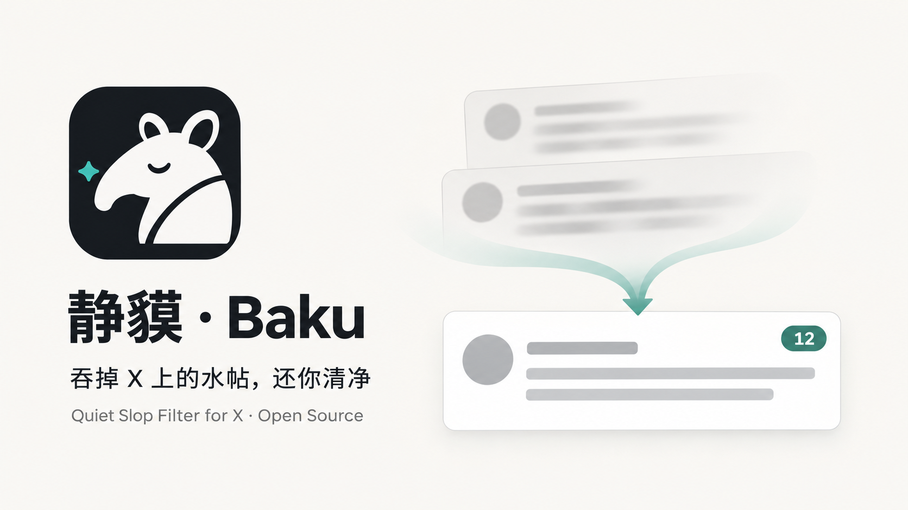

# 静貘 · Baku



**吞掉 X 上的水帖，还你清净。** 静貘 · Baku 是一款开源 Chrome 扩展，在 X (Twitter) 网页端安静隐藏时间线和评论区里的 Slop。

取名「静貘」（Baku），谐音「静默」，借用了夜里悄悄吃掉噩梦的食梦貘。产品脾气参考「熊猫吃短信」：装上就跑，命中的水帖默认直接无痕隐藏，只在浏览器右上角的静貘图标左上角浮现无框数字报数。日常默认按单条帖子判定，同账号屡次命中后再自动升入共享黑名单，保护正常博主的其余内容。

---

## 安装

### Chrome 应用商店（推荐）

前往 Chrome 应用商店一键安装：**[Baku for X Slop](https://chromewebstore.google.com/detail/baku-%E9%9D%99%E8%B2%98-for-x/dkcjdiemeobepaahioaakahjijoigoad)**

安装后打开 `https://x.com` 即可生效（默认已接入公共共享服务，零配置开箱可用）。

### 从源码加载（开发者模式）

```bash
git clone https://github.com/kuhung/baku-for-x.git
```

1. Chrome 打开 `chrome://extensions/`，开启右上角「开发者模式」。
2. 点击「加载已解压的扩展程序」，选择仓库里的 `extension` 目录。
3. 打开 `https://x.com` 即可生效。

---

## 日常使用

- **安静拦截**：默认无痕隐藏命中的 Slop，仅在工具栏图标静默报数；也可在管理台切换为毛玻璃遮罩、原生右下角标或纯静默图标。
- **一键吞帖**：在推文底部操作栏单击静貘小图标即可收起单条水帖，底部提示条提供「拉黑 `@账号`」与「撤销」；右键图标可展开完整操作菜单。
- **阶段伴侣**：弹窗里的静貘会按本机累计拦截条数从「幼貘」逐步成长到「栖星」（`0 / 10 / 100 / 500 / 2,500` 五阶段，阶段只升不降），并在管理台顶栏同步显示当前阶段。
- **随时纠错**：遇到误拦时，在弹窗「最近拦截」或遮罩条点击「放行」或「信任账号」，立即恢复并加入白名单。
- **管理台**：点弹窗里的「打开管理台」可以搜索最近拦截记录、导入导出黑白名单 JSON（`baku-lists-*.json`）、调整扫描范围（仅评论区与引用 / 全部时间线），或填入自有接口密钥在浏览器端直连判别（BYOK）。

---

## 隐私与数据

- **页面视图内运行**：只在当前浏览器页面里收起元素，你的 X 登录状态、关注列表和原生屏蔽列表原封不动。
- **按需发送文本**：开启共享服务时，仅发送未命中本地名单且在扫描范围内（默认仅评论区与引用）的推文正文、作者 handle 及父帖摘要用于判别；主动点击的屏蔽、拉黑与放行会作为匿名信号用于校准共享名单。
- **IP 哈希限流**：公开接口只使用加盐 SHA-256 哈希后的 IP 摘要做防刷限流，原始 IP 不落盘。
- **随时切本地或自建**：在管理台「云端与模型」可关闭共享服务、改用纯本地黑白名单，也可填自己的后端地址或自有 API Key（密钥仅保存在本机浏览器）。

---

## 自建后端（Cloudflare Worker）

`worker/` 与本地 Node 服务共享同一套判别核心，免费 Cloudflare 账号即可跑起来：

```bash
# 1. 创建 D1 数据库并初始化表结构（把返回的 database_id 填入 wrangler.toml）
npx wrangler@4 d1 create anti-slop-db
npx wrangler@4 d1 execute anti-slop-db --remote --file=worker/schema.sql --yes

# 2. 配置判别模型密钥
npx wrangler@4 secret put GEMINI_API_KEY
# （可选）配置自定义 IP 哈希盐值
npx wrangler@4 secret put IP_HASH_SALT

# 3. 发布上线
npx wrangler@4 deploy
```

发布后把 Worker URL 填入扩展管理台「云端与模型」即可。若自行打包分发，同步修改 [`extension/src/shared.js`](extension/src/shared.js) 的 `DEFAULT_FLYWHEEL_URL` 与 [`extension/manifest.json`](extension/manifest.json) 的 `host_permissions`。

---

## 本地调试与测试

本地 Node 服务使用内置 `node:sqlite`（需要 Node.js >= 22.5），接口协议见 [`docs/api-spec.md`](docs/api-spec.md)：

```bash
cp .env.example .env
npm start            # 默认监听 http://127.0.0.1:8787
```

常用测试与回放命令：

```bash
npm test                     # 运行全部扩展与服务端单元测试
npm run pack                 # 校验版本、语言包、文案规则并打包 dist/*.zip
npm run eval                 # 查看本地样本分布（配好密钥可同步跑模型回放）
npm run eval -- --remote     # 拉取线上 D1 样本与统计
npm run logs                 # 查看线上最近判别审计日志与灰区分布
```

---

## 品牌视觉与素材

- 视觉规范与明暗双色系统：[`docs/brand-guidelines.md`](docs/brand-guidelines.md)
- 商店发布文案（简繁中文）：[`docs/store-listing.md`](docs/store-listing.md)
- 五阶段演化设定图：[`docs/assets/baku-stages-sheet.png`](docs/assets/baku-stages-sheet.png)（单阶原稿位于 [`docs/assets/stages/`](docs/assets/stages)）
- 图标与商店素材：[`docs/assets/baku-icon.png`](docs/assets/baku-icon.png)、[`docs/assets/baku-store-promo-1280x800.png`](docs/assets/baku-store-promo-1280x800.png)、[`docs/assets/baku-store-tile-440x280.png`](docs/assets/baku-store-tile-440x280.png)、[`docs/assets/store/`](docs/assets/store)

---

## 开源协议

本项目基于 [MIT License](LICENSE) 开源。
