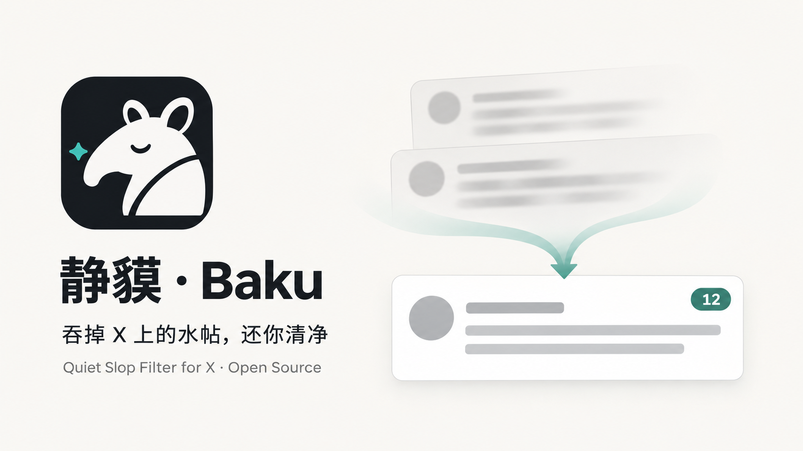

# Baku for X Slop (静貘 · Baku)



**Quietly clear X slop and keep the real conversation.** Baku (`Baku for X Slop` / 静貘) is an open-source Chrome extension for `x.com` and `twitter.com` that hides AI-generated template replies, copy-paste engagement bait, and promotional spam across reply sections and timelines.

Named after the mythological dream-eating Baku (and a Chinese homophone for "silent"), the extension hides matched posts silently by default and updates an unobtrusive counter badge with a subtle nose-star cue on the toolbar icon. Everyday classification evaluates individual posts (`TWEET` scope) first, and only escalates an account to the shared blocklist after repeated hits or multi-user review.

> **UI Language Note**: The current extension popup, dashboard, and Chrome Web Store listing interface are provided in Simplified Chinese (`zh_CN`) and Traditional Chinese (`zh_TW`). For full Chinese documentation, see [README.md](README.md).

---

## Install

### Chrome Web Store

Install directly from the Chrome Web Store: **[Baku for X Slop](https://chromewebstore.google.com/detail/baku-%E9%9D%99%E8%B2%98-for-x/dkcjdiemeobepaahioaakahjijoigoad)**

After installing, open `https://x.com` to start filtering automatically with the default shared flywheel service (no account registration required).

### Load Unpacked from Source

```bash
git clone https://github.com/kuhung/baku-for-x.git
```

1. Open `chrome://extensions/` in Chrome and enable **Developer mode**.
2. Click **Load unpacked** and select the `extension` directory in this repository.
3. Open `https://x.com`.

---

## Key Capabilities

- **Silent hide or frosted mask**: Matched posts are hidden by default (`displayMode: 'hide'`). When 5 or more consecutive replies are hidden, a compact expandable notice remains inline so you can inspect them temporarily. You can also switch to a frosted mask (`mask`) and configure toolbar badge styles (`corner`, `count`, or `none`) in the dashboard.
- **One-click hide and contextual controls**: Click the Baku icon injected into any tweet action bar to hide a single post with quick **Block `@author`** and **Undo** options. Right-click or Shift-click the icon for a full menu covering single-post hiding, author blocking, and repost/quote author blocking.
- **Single-post allowlist vs. account trust**: Choose **Allow this post** (`放行此条`) to restore a single tweet without trusting the account, or choose **Trust account** (`信任账号`) to restore all posts from that author and add them to your local whitelist.
- **Five-stage Baku companion**: The extension popup and dashboard top bar unlock five visual Baku stages one-way as your local cumulative filtered count grows (`0` / `10` / `100` / `500` / `2,500`).
- **Searchable dashboard and JSON backup**: Search recent filtered captures by `@handle` or tweet text, review local blacklists, cloud blacklists, and local whitelists, and import or export JSON list backups.

---

## Privacy and Deployment Modes

- **Local DOM display only**: Baku only adjusts how posts display inside your active browser tab. It does not modify your X login session, following list, or native X mute/block lists.
- **Shared flywheel mode (default)**: Only tweets within your active scan scope (`replies` by default, or `all` timeline + replies) that miss your local lists are checked via `/api/v1/classify/batch` using a random local `clientId`. Explicit block/allow actions send anonymous feedback signals to `/api/v1/signal`. Rate limiting uses a salted SHA-256 IP digest and never stores raw IP addresses.
- **Local-only and self-hosted options**: Disable the shared flywheel in the dashboard to run purely on local block/allow lists and manual hiding, configure your own direct API endpoint and key stored locally in your browser (BYOK), or deploy your own Cloudflare Worker from [`worker/`](worker/).

---

## License

[MIT](LICENSE)
